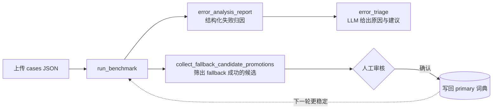
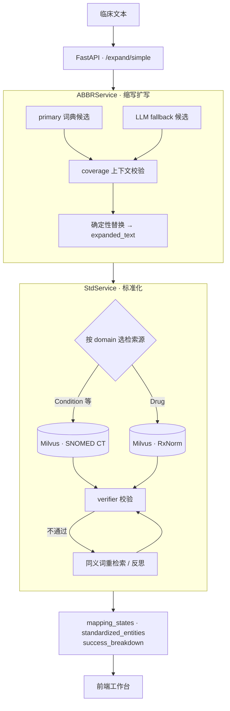

<div align="center">


# Medical NLP V11

**临床文本医学缩写的扩写 · 标准概念映射 · 评估复盘工作台**

把临床文本里的 `SOB`、`CP` 这类缩写展开成完整术语，再映射到 **SNOMED CT / RxNorm** 标准概念；<br/>
拿不准的结果宁可拒绝编码，也不强行给出错误答案。


[效果演示](#-效果演示) · [核心设计](#-核心设计) · [快速开始](#-快速开始) · [Benchmark](#-benchmark-与评估闭环) · [架构](#-系统架构) · [API](#-api-一览)

</div>

---

## ✨ 一句话看懂

| 输入 | 扩写 | 标准化 |
| --- | --- | --- |
| `The patient has SOB and CP.` | The patient has **shortness of breath** and **chest pain**. | `SOB` → Dyspnea（SNOMED · Condition） <br/> `CP` → Chest pain（SNOMED · Condition） |

每个缩写都带结构化状态（`CODED` / `WITHHELD` / `NOT_EXPANDED` / `ABSTAIN` …）、来源、上下文校验结果和失败原因，方便人工复核与批量评估。

> [!NOTE]
> 当前生产主链路聚焦**医学缩写的扩写与标准化**，不是覆盖整句所有医学实体的通用 NER 系统。项目用于技术展示与工程验证，不构成任何医学诊断或治疗建议。

## 📸 效果演示

<table>
  <tr>
    <td width="50%"><b>Analyze · 单句缩写分析</b><br/></td>
    <td width="50%"><b>Benchmark Overview · 批量评估</b><br/></td>
  </tr>
  <tr>
    <td width="50%"><b>Error Analysis · 失败归因 + LLM 建议</b><br/></td>
    <td width="50%"><b>Fallback Promotions · 候选人工审核入库</b><br/></td>
  </tr>
</table>

## 🧠 核心设计

| 设计点 | 做法 | 为什么这样做 |
| --- | --- | --- |
| **词典优先，LLM 兜底** | 先查本地 `primary` 缩写词典，查不到再调用 LLM 生成 fallback 候选 | 常见缩写稳定、可控、零成本；长尾缩写由 LLM 补位 |
| **上下文 coverage 校验** | 结合原句、候选扩写和 domain 判断候选是否符合当前语境 | 同一缩写在不同句子里含义不同（如 `RA`） |
| **确定性替换** | 只有通过校验的扩写才写入 `expanded_text` | 扩写文本可复现，不让 LLM 直接改写原句 |
| **向量检索 + 验证 + 反思** | BGE-M3 向量检索 Milvus 中的 SNOMED / RxNorm → verifier 校验 → 必要时同义词重检索 | 检索召回 + LLM 把关，减少"看起来像但不对"的概念 |
| **宁可拒绝，不乱编码** | 不可靠时返回 `WITHHELD` / `ABSTAIN`，并附 failure、evidence、suggestion | 医疗场景下，错误编码比不编码代价更高 |
| **评估闭环** | Benchmark → 错误分析 → LLM triage → fallback 候选人工审核 → 回写词典 | 系统能从失败里持续变好，而不是一次性 demo |
| **可观测性** | 前后端分职责写 JSONL 日志，用 `request_id` / `job_id` 串起整条链路 | 出问题时能定位到具体阶段、依赖和耗时 |

### 结果状态说明

| 状态 | 含义 |
| --- | --- |
| `CODED` | 扩写成功，且找到可靠的标准概念 |
| `WITHHELD` | 扩写成功，但标准概念不够可靠，系统**主动拒绝编码**（≠ 成功） |
| `NOT_EXPANDED` | 无法在当前语境下安全扩写 |
| `ABSTAIN` | 系统放弃判断，交由人工处理 |
| `PENDING` | 处理中 / 尚未得到最终结果 |

## 🚀 快速开始

> [!TIP]
> 第一次体验推荐 **Docker 简易演示版**：只用仓库自带的 `SNOMED_5000.csv`，几步即可在浏览器里看到完整主流程。

**前置条件**：Docker Desktop、一个 [DeepSeek API Key](https://platform.deepseek.com/)、首次运行需联网（自动从 Hugging Face 下载 BGE-M3，缓存在 `model_cache/huggingface/`）。

```powershell
# 1. 准备配置，并在 backend/.env 中填写 DEEPSEEK_API_KEY
Copy-Item backend/.env.example backend/.env

# 2. 启动 API、Milvus、etcd、MinIO
docker compose up -d --build
docker compose ps

# 3. 用自带的小型 SNOMED 数据建库（collection: concepts_only_name）
docker compose exec api python tools/milvus/create_milvus_db.py
```

打开 **http://127.0.0.1:8000/app** ，在 Analyze 页面输入 `The patient has SOB and CP.` 点击「分析」即可。

<details>
<summary><b>简易演示版的限制</b></summary>

- 只包含 5000 条 SNOMED 演示概念，覆盖范围有限；不含 RxNorm，无法完整演示药品标准化。
- 某些扩写正确但演示库里没有对应概念时，会返回 `WITHHELD`。
- 在演示库上跑出的 Benchmark 只用于流程演示，不代表完整词库下的准确率。

</details>

<details>
<summary><b>完整数据库版（SNOMED CT + RxNorm）</b></summary>

完整版需要自行准备 Athena / OHDSI 的 `CONCEPT.csv`（或等价数据源）。原始数据、模型和 Milvus collection 都不放进 GitHub。

1. 修改 `backend/tools/data/build_concept_csv.py` 与 `build_rxnorm_csv.py` 中的 `INPUT_CSV`，指向你的 `CONCEPT.csv`。
2. 生成完整 CSV（已被 `.gitignore` 忽略，Compose 会挂载 `backend/data/`）：

   ```powershell
   python backend/tools/data/build_concept_csv.py   # -> backend/data/snomed_clinical.csv
   python backend/tools/data/build_rxnorm_csv.py    # -> backend/data/rxnorm_clinical.csv
   ```

3. 启动服务并构建两个 collection：

   ```powershell
   docker compose up -d --build
   docker compose exec api python tools/milvus/rebuild_milvus.py         # -> concepts_only_name
   docker compose exec api python tools/milvus/rebuild_rxnorm_milvus.py  # -> rxnorm_concepts
   ```

完整数据量较大，建库时间和磁盘占用明显高于演示版。

</details>

<details>
<summary><b>本机开发启动（不使用 Docker 跑 API）</b></summary>

本机启动不会自动拉起 Milvus / etcd / MinIO，需要先单独启动它们（或连接已运行的 Docker Milvus）。

```powershell
cd backend
..\.venv\Scripts\python.exe -m uvicorn api.main:app --host 127.0.0.1 --port 8001
```

| 入口 | 地址 |
| --- | --- |
| 前端工作台 | http://127.0.0.1:8001/app |
| Swagger 文档 | http://127.0.0.1:8001/docs |
| 健康检查 | http://127.0.0.1:8001/health |

建库命令同上，去掉 `docker compose exec api` 前缀并以仓库根目录下的 `backend/tools/milvus/...` 路径执行即可。

</details>

## 📊 Benchmark 与评估闭环

最近一次上传评估（50 个自建 case，2 个 worker 并行）：

| 分类 | Cases | 正确 | Accuracy | 平均延迟 |
| --- | ---: | ---: | ---: | ---: |
| 单一含义缩写 `single_meaning` | 10 | 10 | 100% | 5.8 s |
| 一句多个缩写 `multi_abbreviation` | 10 | 10 | 100% | 8.2 s |
| 否定语境保持 `negation_preservation` | 10 | 10 | 100% | 5.3 s |
| 需 LLM 兜底扩写 `fallback_should_expand` | 10 | 10 | 100% | 7.4 s |
| 低上下文缩写 `low_context_abbreviation` | 10 | 7 | 70% | 6.0 s |
| **合计** | **50** | **47** | **94%** | **6.5 s**（P95 11.9 s） |

> 评估口径为 case 级：一个 case 中任一映射与 gold 不一致即判失败。样本量较小，数字用于展示评估流程与相对表现，不代表通用准确率。失败主要集中在低上下文场景（例如额外扩写了 gold 未要求的 `ABC`），也正是错误分析页面要定位的问题。

**评估闭环**：



<details>
<summary><b>上传文件格式与命令行运行</b></summary>

```json
{
  "cases": [
    {
      "id": "demo_001",
      "category": "single_meaning",
      "text": "The patient has SOB.",
      "expected_mappings": [
        { "abbreviation": "SOB", "expansion": "shortness of breath" }
      ]
    }
  ]
}
```

样例数据见 [`examples/benchmarks/`](examples/benchmarks/)。命令行运行：

```powershell
$env:BENCH_WORKERS="2"   # 可选，并行 worker 数
python backend/evaluation/run_benchmark.py
```

当前结果写入 `backend/evaluation/runtime/`，历史结果自动归档到 `backend/evaluation/archive/`。

</details>

## 🏗 系统架构



两层职责边界：

- **扩写**回答「这个缩写在当前句子里应该展开成什么？」
- **标准化**回答「这个扩写对应哪个标准医学概念？」

`success`、`expansion_success`、`standardization_success` 是三个不同层级的状态，`WITHHELD` 不计入标准化成功。`backend/graph/` 中用 LangGraph 实现了标准化流程的实验版本并可导出流程图（见 [`backend/graph/README.md`](backend/graph/README.md)），当前 API 的生产入口不经过它。

## 🔌 API 一览

| 方法 | 路径 | 说明 |
| --- | --- | --- |
| `POST` | `/expand/simple` | 主链路：缩写扩写 + 标准化 |
| `POST` | `/analysis/diagnose` | 对单句结果生成 LLM 诊断说明 |
| `POST` | `/benchmark/cases/jobs` | 上传 cases，创建异步 benchmark 任务 |
| `GET` | `/benchmark/cases/jobs/{job_id}` | 查询 benchmark 任务进度 |
| `GET` | `/benchmark/summary` · `/benchmark/results` | 读取评估汇总与明细 |
| `GET` | `/error-analysis/report` · `/error-analysis/triage` | 结构化错误分析 / LLM triage |
| `GET` | `/candidate-promotions` | 待审核的 fallback 候选 |
| `POST` | `/candidate-promotions/apply` · `/apply-single` | 批量 / 单条写入 primary 词典 |
| `GET` | `/health` | 健康检查 |
| `GET` | `/app` | 前端工作台 |

完整请求 / 响应模型见启动后的 Swagger（`/docs`）或 [`backend/api/schemas.py`](backend/api/schemas.py)。

## 🧰 技术栈

| 层 | 选型 |
| --- | --- |
| 后端 | Python 3.12 · FastAPI · Uvicorn · Pydantic |
| LLM 编排 | LangChain（DeepSeek）· LangGraph |
| 向量检索 | BGE-M3（sentence-transformers）· Milvus（etcd + MinIO） |
| 标准术语 | SNOMED CT · RxNorm（来自 Athena / OHDSI） |
| 前端 | 原生 JavaScript 单页应用（自研路由 / 状态 / 组件，无构建步骤） |
| 工程化 | Docker Compose · pytest · Ruff · GitHub Actions · JSONL 结构化日志 |

## 📁 项目结构

```text
medical-nlp/
├─ backend/
│  ├─ api/            # FastAPI 入口、静态前端托管、请求/响应模型
│  ├─ services/       # 核心链路：缩写检索 / fallback / coverage / 验证 / 标准化 / LLM 解释
│  ├─ data/           # primary 缩写词典 + 演示用 SNOMED_5000.csv
│  ├─ evaluation/     # benchmark、性能报告、错误分析、LLM triage、候选沉淀
│  ├─ graph/          # LangGraph 流程实验与流程图导出
│  ├─ tools/          # 概念 CSV 生成、Milvus 建库
│  ├─ utils/          # LLM / Embedding 工厂、结构化日志、trace 上下文
│  └─ tests/          # unit · api · integration · live · manual
├─ frontend/          # 工作台：pages / components / state / api / utils
├─ examples/benchmarks/
├─ docs/              # 架构设计、性能指标方案与 README 截图
├─ Dockerfile
└─ docker-compose.yml
```

<details>
<summary><b>展开 services/ 各文件职责</b></summary>

| 文件 | 职责 |
| --- | --- |
| `abbr_service.py` | 缩写主链路编排 |
| `abbr_candidate_retriever.py` | 从 primary 词典取候选 |
| `abbr_candidate_fallback_retriever.py` | LLM 生成 fallback 候选 |
| `abbr_candidate_coverage_evaluator.py` | 上下文 coverage 判断 |
| `abbr_verifier.py` | 扩写与标准化结果验证 |
| `std_service.py` | 标准概念检索、校验与重检索 |
| `medical_retriever.py` | Milvus 检索适配 |
| `medical_ner.py` | fallback 使用的实体识别 |
| `diagnosis_explainer.py` | 单句与 benchmark 的 LLM 解释 |

</details>

## ✅ 测试与 CI

```powershell
cd backend
..\.venv\Scripts\python.exe -m pytest -q     # 14 passed, 2 deselected
```

| 层级 | 默认运行 | 内容 |
| --- | :---: | --- |
| `unit` | ✅ | success 统计、确定性替换、benchmark 分类统计、候选筛选 |
| `api` | ✅ | FastAPI 接口合同 |
| `integration` | ⏸ `RUN_INTEGRATION=1` | 真实 Milvus 集成 |
| `live` | ⏸ `RUN_LIVE=1` | 真实 LLM + Embedding + Milvus 全链路 |

默认测试不依赖 LLM、模型、Milvus 或 Docker，可在干净环境稳定运行；GitHub Actions 在每次 push / PR 到 `main` 时执行。详见 [`backend/tests/README.md`](backend/tests/README.md) 与 [`TEST_INVENTORY.md`](backend/tests/TEST_INVENTORY.md)。

<details>
<summary><b>⚙️ 配置变量</b></summary>

```env
DEEPSEEK_API_KEY=your_deepseek_api_key
DASHSCOPE_API_KEY=your_dashscope_api_key
MILVUS_URI=http://127.0.0.1:19530
MILVUS_COLLECTION_NAME=concepts_only_name
MILVUS_RXNORM_COLLECTION=rxnorm_concepts
BENCH_WORKERS=1
REFLECT_MAX_ITER=2
```

完整变量（含日志参数）以 [`backend/.env.example`](backend/.env.example) 为准。`backend/.env` 仅用于本地，不要提交。

</details>

<details>
<summary><b>🔍 日志与可观测性</b></summary>

后端按职责写入 JSONL：

| 文件 | 记录内容 |
| --- | --- |
| `app.jsonl` | 应用与请求日志 |
| `pipeline.jsonl` | 扩写 / 标准化各阶段 |
| `dependency.jsonl` | LLM、Embedding、Milvus 调用与耗时 |
| `benchmark.jsonl` | benchmark 任务过程 |
| `audit.jsonl` | 写入 primary 词典等审计操作 |
| `frontend.jsonl` | 前端上报日志 |

业务返回的 `mapping_states` / `failure` 说明「结果是什么」；日志说明「请求何时经过哪个阶段、依赖是否可用、耗时多少」。

前端日志默认存在浏览器 buffer，调试时可在 Console 执行：

```javascript
window.frontendLogger.print()                                  // 打印日志
localStorage.setItem("medicalNlpFrontendLogConsole", "1")      // 打开 INFO 自动输出
localStorage.removeItem("medicalNlpFrontendLogConsole")        // 关闭
```

</details>

## 📚 深入文档

- [V11 系统架构设计](docs/V11系统架构设计.md)
- [V11 性能指标采集与 Benchmark 实施方案](docs/V11性能指标采集与Benchmark实施方案.md)
- [V11 性能指标采集实施记录](docs/V11性能指标采集实施记录.md)
- [评估模块说明](backend/evaluation/README.md) · [测试说明](backend/tests/README.md) · [LangGraph 流程](backend/graph/README.md)

## 🗺 边界与后续方向

**当前边界**

- 主流程只处理医学缩写，不承诺覆盖整句所有医学实体。
- fallback、coverage、verifier、LLM triage 依赖可用的 LLM API。
- 标准化效果取决于 Milvus collection、embedding 模型和数据质量。

**后续计划**

- [ ] 新增 `/full-standardize`：整段临床文本的 NER + 实体标准化
- [ ] Benchmark 数据集版本管理与固定回归集、串行 / 并行对照
- [ ] 将 integration / live 测试接入可控的 Docker 验证流程
- [ ] 细化 Embedding、Milvus、LLM 各依赖阶段的可观测性
- [ ] 扩充医学实体类型与药品标准化能力

## 📄 License

当前未指定开源许可证，主要用于个人项目展示、学习与面试交流。
